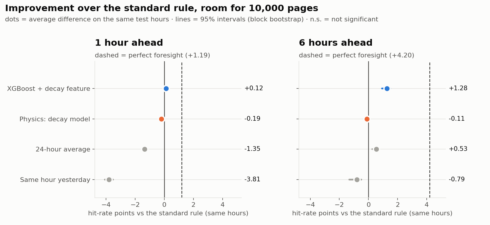
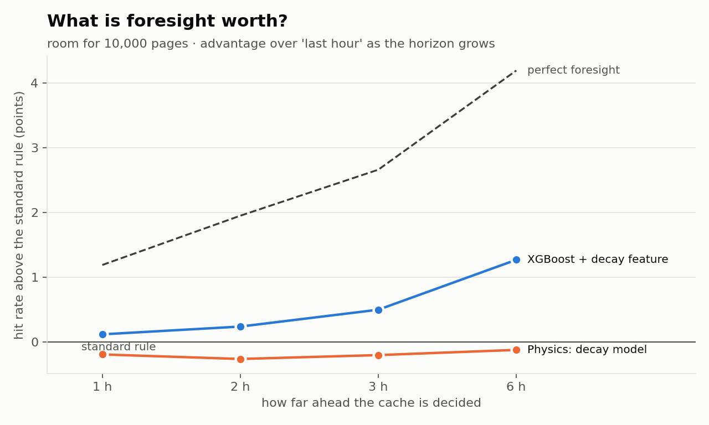

[README (3).md](https://github.com/user-attachments/files/33921469/README.3.md)
# Ahead of the Spike

**Can we predict what Wikipedia will read next hour well enough to beat the standard caching rule?**

Every Wikipedia page view is served either from a fast cache or, more slowly, from the main servers. Suppose a cache can hold only the top *N* articles and is refilled once an hour. Which articles should it hold? The standard answer is "whatever was popular last hour". We tried to do better by forecasting the next hour, using a fitted model of how attention decays after a spike and an XGBoost model that uses that decay as a feature.

Because a cache doesn't change what people read, replaying real history gives an exact backtest. We scored every method on **72 hours of English Wikipedia traffic it never saw during training**.



---

## Results

All numbers are for English Wikipedia (desktop + mobile), test period 20–23 Oct 2026, deciding 1 hour ahead unless stated. Intervals are 95% block-bootstrap intervals over hours. Full numbers: [`out/charts/key_numbers.md`](out/charts/key_numbers.md) (10k cache) and [`out/charts_100k/key_numbers.md`](out/charts_100k/key_numbers.md) (100k cache).

### Hit rate: share of next hour's views served from cache

| Method | 1,000 pages | 10,000 pages | 100,000 pages |
|---|---|---|---|
| Perfect foresight (ceiling) | 16.7% | 41.7% | 89.8% |
| **XGBoost + decay feature** | 15.9% | **40.6%** | **86.6%** |
| Last hour (standard rule) | 15.9% | 40.5% | 85.2% |
| Decay model (Physics) | 15.7% | 40.3% | 85.6% |
| 24-hour average | 14.7% | 39.1% | 85.5% |
| Same hour yesterday | 12.8% | 36.7% | 82.2% |

**What this shows:**

- **The standard rule is already close to the ceiling at small caches.** With 10,000 pages, perfect foresight beats "last hour" by only 1.2 points. XGBoost's lead there is small (+0.12 points) but significant: it is ahead in 94% of hours.
- **Prediction matters more as the cache grows.** With 100,000 pages the ceiling is 4.6 points above the standard rule. XGBoost recovers **+1.4 points, about 30% of that gap**, and beats the standard rule in every one of the 72 test hours.
- **Foresight is worth more the further ahead you must decide.** If the cache needs 6 hours' notice to warm up, XGBoost leads the standard rule by +1.3 points at 10k and +3.1 points at 100k.



### The physics of attention

We fitted the decay of 1,429 spikes in the training days. A spike is ≥ 1,000 views/hour and ≥ 10× the page's median over the previous day.

- **Extra attention fades like a power law, not an exponential:** excess ∝ (1 + t/τ)^−α with **α = 1.79, τ = 0.87 h**.
- **Half-life of about 25 minutes** after the peak.
- **A daily echo:** 23 hours after the peak, extra attention climbs back to about 2% of the peak, 1.5× its low point. People come back at the same time the next day.


On its own, the decay model only beats the standard rule at the largest cache size (+0.3 points at 100k). At any given moment most pages aren't decaying from a spike, so the decay model's main contribution is as a feature inside XGBoost.

### Spikes

With 10,000 pages, the standard rule, XGBoost and the decay model all have the median spike cached in its first hour (lag 0). The 24-hour average is 1 hour late; same hour yesterday is 14 hours late. Most spikes build up over more than one hour, so "last hour" sees them coming. The standard rule actually serves slightly more of spike pages' views in their first 6 hours (93.5%) than XGBoost (92.8%). XGBoost's advantage comes from ordinary, non-spiking pages.

A page that goes from nothing to a huge spike within a single hour can't be predicted from hourly data, and every method catches it an hour late. That is a limit of the data, not of the model. Example: *Tom Skerritt*, peaking at 97,628 views/hour (`out/charts/7_spike_example.png`).

### Honest limits

- **Hourly decisions.** Real caches decide per request. This is a simplified model of caching, though an exact backtest of that model.
- **Every page counts as the same size.** Article sizes aren't in the pageview data.
- **About five days of data.** The test period is 3 days, so weekly patterns aren't captured.
- **Bots aren't removed.** `checks.py` flags pages with automated-looking traffic but excludes nothing.

---

## Quick start

```bash
pip install pandas pyarrow numpy scipy xgboost matplotlib requests
```

The data isn't in the repo: the real `views.parquet` exceeds GitHub's 100 MB limit. Either download it or make fake data.

```bash
# 1. Data: real (about 5 days, run overnight or on Colab) ...
python download.py --start "2026-10-18 00:00" --end "2026-10-23 02:00"
python checks.py                     # missing hours, suspected bots
#    ... or fake, for development
python make_fake_data.py

# 2. Fit the decay model, then train XGBoost (training hours only)
python fit_decay.py                  # -> models/decay_params.json, out/decay_fit.png
python train_xgb.py                  # -> models/xgb_h{1,2,3,6}.json

# 3. Score everything on the held-out 3 days
python backtest.py                   # -> out/results.csv, out/hourly.csv, out/demo.json

# 4. Slide charts and key numbers
python make_charts.py                # -> out/charts/
python make_charts.py --cache-size 100000 --out out/charts_100k
```

On fake data, use small cache sizes (it has only 3,000 pages): `python backtest.py --sizes 100 300 1000 --demo-size 300`. `python quick_check.py` is a quick sanity check of every predictor.

If several laptops downloaded different hours, merge them with `python combine_parquets.py data/views.parquet other.parquet laptop2.zip`.

---

## How it works

```
download.py ─► data/views.parquet ─► fit_decay.py ─► train_xgb.py ─► backtest.py ─► make_charts.py
   (EIE)        hour, page, views      (Physics)      (Computing)    (Computing)     (slides)
                                                                          │
                                                                          └─► demo.json ─► demo
```

- **Data.** `download.py` streams Wikimedia's hourly pageview dumps and keeps only English desktop (`en`) and mobile (`en.m`) views, added together. It drops non-article pages and saves each hour as soon as it's done, so a wifi cut-out loses at most one hour. Raw files are never kept.
- **Predictors.** Every model is a single function, `predict(history, now, horizon) -> pd.Series` of predicted views per page. It only ever receives rows with `hour <= now`, and is registered in `predictors/__init__.py`.
  - `baselines.py`: last hour (standard rule, ≈ LRU), 24-hour average (≈ LFU), same hour yesterday
  - `decay_predict.py`: baseline + current excess × f(t + h)/f(t), with f the fitted decay curve
  - `xgb.py` / `xgb_features.py`: XGBoost on recent views, differences, peak timing, hour and weekday, plus the decay model's forecast, with one model per horizon. Training and prediction share the same feature code, so they can't drift apart.
- **Backtest.** For each test hour, predictor, cache size (1k / 10k / 100k) and horizon (1, 2, 3, 6 h), `backtest.py` caches the top *N* predicted pages. It scores the share of the actual views at hour `now + h` that land in the cache. It also runs the perfect-foresight ceiling, measures how late each spike was caught, and bootstraps intervals.
- **Training/test split.** The last 3 days are the test period. `fit_decay.py` and `train_xgb.py` use only hours before it.

The exact contract between the parts (file formats, settings, spike definition, `demo.json` shape) is in [`INTERFACES.md`](INTERFACES.md). A walkthrough of the code is in *Ahead of the Spike — Codebase Guide.pdf*.

## Repository layout

```
download.py           fetch hourly pageviews -> data/views.parquet          (EIE)
combine_parquets.py   merge parquets from several machines                 (EIE)
checks.py             missing hours, suspected bots                        (EIE)
make_fake_data.py     fake views.parquet + demo.json for development       (Computing)
fit_decay.py          fit attention decay on training spikes               (Physics)
train_xgb.py          train XGBoost per horizon                            (Computing)
backtest.py           score all predictors, write results + demo.json      (Computing)
make_charts.py        slide charts + key_numbers.md
quick_check.py        fast sanity check of all predictors
predictors/           baselines, decay model, XGBoost + features
out/                  results.csv, hourly.csv, charts/, charts_100k/
demo.json             replay of 22 Oct 2026 for the demo                    (Design Eng)
INTERFACES.md         the agreed formats between all parts
```

## Team

Built overnight at a hackathon by a team of second-year students: **Computing** (models and backtest), **Physics** (decay model and statistics), **EIE** (data pipeline) and **Design Engineering** (demo and story).

## Data source

[Wikimedia hourly pageviews](https://dumps.wikimedia.org/other/pageviews/) ([readme](https://dumps.wikimedia.org/other/pageviews/readme.html)), released under CC0. A stretch goal we didn't reach: testing per request with Wikimedia's anonymised caching-server request traces ([T225538](https://phabricator.wikimedia.org/T225538)).
