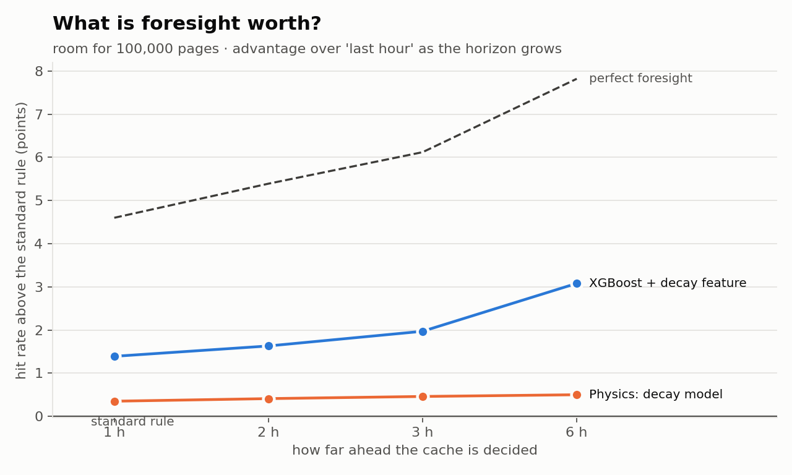
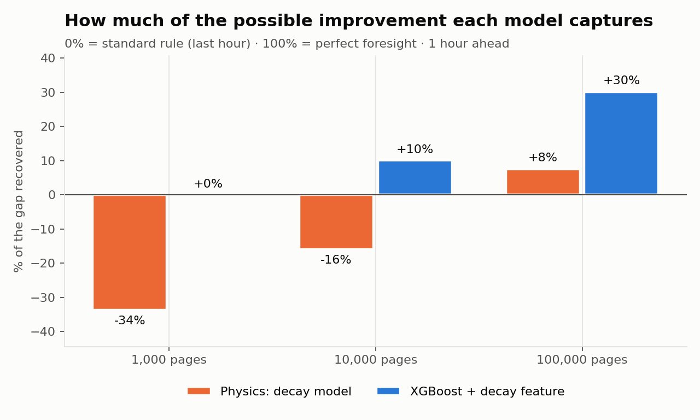
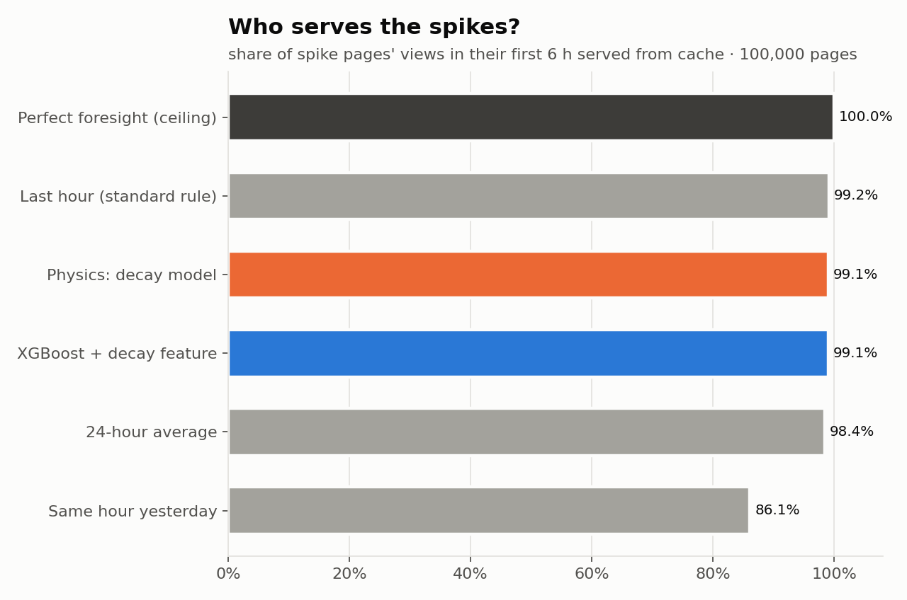

# Ahead of the Spike

**Can we predict what Wikipedia will read next hour well enough to beat the standard caching rule?**

Every Wikipedia page view is served either from a fast cache or, more slowly, from the main servers. Suppose a cache holds the top **100,000** English articles and is refilled once an hour. Which articles should it hold? The standard answer is "whatever was popular last hour". We tried to do better by forecasting the next hour, using a fitted model of how attention decays after a spike and an XGBoost model that uses that decay as a feature.

Because a cache doesn't change what people read, replaying real history gives an exact backtest. We scored every method on **72 hours of English Wikipedia traffic (20–23 Oct 2026) that no model saw during training**.

> **Headline (100,000-page cache, 1 hour ahead):** XGBoost serves **86.6%** of views from cache against **85.2%** for the standard rule. That is **+1.4 points**, about **30% of the gap to perfect foresight**, and XGBoost is ahead in **every one of the 72 test hours**. When the cache must be decided 6 hours ahead, the lead grows to **+3.1 points**.


---

## Results (cache of 100,000 pages)

All numbers are for English Wikipedia, desktop and mobile combined. Intervals are 95% block-bootstrap intervals over hours. The full list is in [`out/charts_100k/key_numbers.md`](out/charts_100k/key_numbers.md), and the raw scores are in [`out/results.csv`](out/results.csv).

### Hit rate: share of views served from cache

| Method | 1 h ahead | 95% interval | 6 h ahead |
|---|---|---|---|
| Perfect foresight (ceiling) | 89.8% | 89.7–90.0% | 89.8% |
| **XGBoost + decay feature** | **86.6%** | 86.4–86.8% | **85.1%** |
| Decay model (Physics) | 85.6% | 85.3–85.8% | 82.5% |
| 24-hour average | 85.5% | 85.3–85.7% | 84.6% |
| Last hour (standard rule) | 85.2% | 85.0–85.5% | 82.0% |
| Same hour yesterday | 82.2% | 81.9–82.5% | 82.2% |

Compared with the standard rule on the same hours (paired, 1 hour ahead):

| Method | Points above the standard rule | 95% interval | Hours ahead of it | Share of the gap to perfect foresight recovered |
|---|---|---|---|---|
| Perfect foresight | +4.60 | +4.27 to +5.04 | 100% | 100% |
| **XGBoost + decay feature** | **+1.38** | +1.26 to +1.56 | **100%** | **30%** |
| Decay model (Physics) | +0.34 | +0.27 to +0.44 | 100% | 8% |

**What this shows:**

- **With a cache this size, prediction pays off.** The standard rule leaves 4.6 points on the table. XGBoost recovers 30% of that and is never worse in any test hour. Every improvement in the table is statistically significant.
- **The decay model alone gives a small but consistent gain**: +0.34 points, ahead in every hour. Its main value is as a feature inside XGBoost (see below).
- **"Last hour" is the most fragile rule.** Deciding 6 hours ahead, it drops to 82.0%, below even "same hour yesterday". XGBoost holds 85.1%.

### What is foresight worth?

A real cache needs time to warm up. The further ahead it must be decided, the more prediction is worth:

| Hours ahead | XGBoost vs standard rule | Decay model vs standard rule | Perfect foresight vs standard rule |
|---|---|---|---|
| 1 | +1.39 | +0.35 | +4.60 |
| 2 | +1.63 | +0.41 | +5.39 |
| 3 | +1.97 | +0.46 | +6.12 |
| 6 | **+3.08** | +0.50 | +7.82 |



### Bigger caches gain more

At 100,000 pages, both models close part of the gap. At smaller caches the standard rule is already close to the ceiling (1.2 points at 10,000 pages), so there is little left to win. XGBoost recovers 10% of the gap at 10,000 pages and 0% at 1,000. The decay model on its own is worse than the standard rule at those sizes.



| Cache size | Perfect foresight | XGBoost | Last hour (standard) | Decay model |
|---|---|---|---|---|
| 1,000 | 16.7% | 15.9% | 15.9% | 15.7% |
| 10,000 | 41.7% | 40.6% | 40.5% | 40.3% |
| **100,000** | **89.8%** | **86.6%** | **85.2%** | **85.6%** |

(Hit rate, 1 hour ahead.)

### The physics of attention

We fitted the decay of **1,429 spikes** in the training days. A spike is at least 1,000 views/hour and at least 10× the page's median over the previous 24 hours.

- **Extra attention fades like a power law, not an exponential:** excess ∝ (1 + t/τ)^−α with **α = 1.79, τ = 0.87 h**. An exponential fits clearly worse.
- **Half-life of about 25 minutes** after the peak.
- **A daily echo:** 23 hours after the peak, extra attention climbs back to about 2% of the peak, 1.5× its low point. People come back at the same time the next day.


At any moment, most pages are not decaying from a spike. That is why the decay curve helps most as a feature that tells XGBoost *how fast* a hot page is cooling.

### Spikes

With room for 100,000 pages, almost every spike page is already in the cache. Every method except "same hour yesterday" serves about 98–99% of spike pages' views in their first 6 hours (standard rule 99.2%, XGBoost 99.1%, decay model 99.1%). The median catch lag is 0 hours for all of them. So at this cache size XGBoost's advantage comes from **ordinary, non-spiking pages**, which the standard rule ranks less well.



A page that goes from nothing to a huge spike within a single hour can't be predicted from hourly data, and every method catches it an hour late. That is a limit of the data, not of the model. Example: *Tom Skerritt*, peaking at 97,628 views/hour ([chart](out/charts/7_spike_example.png)).

### Honest limits

- **Hourly decisions.** Real caches decide per request. This is a simplified model of caching, though an exact backtest of that model.
- **Every page counts as the same size.** Article sizes aren't in the pageview data, so "100,000 pages" is a page count, not a byte budget.
- **About five days of data.** The test period is 3 days, so weekly patterns aren't captured.
- **Bots aren't removed.** `checks.py` flags pages with automated-looking traffic but excludes nothing.

Results for a 10,000-page cache are in [`out/charts/`](out/charts/) and [`out/charts/key_numbers.md`](out/charts/key_numbers.md).

---

## Quick start

### Run the website (offline, from the published results)

```bash
python -m venv .venv
.venv\Scripts\activate            # macOS/Linux: source .venv/bin/activate
pip install -r requirements.txt
uvicorn api:app --host 127.0.0.1 --port 8000
```

Open <http://127.0.0.1:8000/demo/#start>. FastAPI serves the website and the API from the published files (`demo.json`, `out/results.csv`, `out/hourly.csv`, `out/value_metrics.csv`); no internet is needed. With the API running, the Results page lets you choose any cache size (1,000 / 10,000 / 100,000) and planning horizon (1 / 2 / 3 / 6 h), the day replay can show each article's cache status, and the header search finds articles in the recorded day. Served by a plain static server instead (`python -m http.server`), the site still shows the confirmed 100,000-page results. Endpoint tests: `python -m pytest test_api.py`.

### Rebuild the results

```bash
pip install pandas pyarrow numpy scipy xgboost matplotlib requests
```

The data isn't in the repo, because the real `views.parquet` exceeds GitHub's 100 MB limit. Either download it or make fake data.

```bash
# 1. Data: real (about 5 days, run overnight or on Colab) ...
python download.py --start "2026-10-18 00:00" --end "2026-10-23 02:00"
python checks.py                     # missing hours, suspected bots
#    ... or fake, for development
python make_fake_data.py

# 2. Fit the decay model, then train XGBoost (training hours only)
python fit_decay.py                  # -> models/decay_params.json, out/decay_fit.png
python train_xgb.py                  # -> models/xgb_h{1,2,3,6}.json

# 3. Score everything on the held-out 3 days
python backtest.py                   # -> out/results.csv, out/hourly.csv, out/demo.json

# 4. Charts and key numbers for the 100,000-page cache (and the default 10,000)
python make_charts.py --cache-size 100000 --out out/charts_100k
python make_charts.py                # -> out/charts/
```

On fake data, use small cache sizes, because it has only 3,000 pages: `python backtest.py --sizes 100 300 1000 --demo-size 300`. `python quick_check.py` is a quick sanity check of every predictor.

If several laptops downloaded different hours, merge them with `python combine_parquets.py data/views.parquet other.parquet laptop2.zip`.

---

## How it works

```
download.py ─► data/views.parquet ─► fit_decay.py ─► train_xgb.py ─► backtest.py ─► make_charts.py
   (EIE)        hour, page, views      (Physics)      (Computing)    (Computing)     (slides)
                                                                          │
                                                                          └─► demo.json ─► demo
```

- **Data.** `download.py` streams Wikimedia's hourly pageview dumps and keeps only English desktop (`en`) and mobile (`en.m`) views, added together. It drops non-article pages and saves each hour as soon as it's done, so a wifi cut-out loses at most one hour. Raw files are never kept.
- **Predictors.** Every model is a single function, `predict(history, now, horizon) -> pd.Series` of predicted views per page. It only ever receives rows with `hour <= now`, and is registered in `predictors/__init__.py`.
  - `baselines.py`: last hour (the standard rule, ≈ LRU), 24-hour average (≈ LFU), same hour yesterday.
  - `decay_predict.py`: baseline + current excess × f(t + h)/f(t), where f is the fitted decay curve.
  - `xgb.py` / `xgb_features.py`: XGBoost on recent views, differences, peak timing, hour and weekday, plus the decay model's forecast. There is one model per horizon. Training and prediction share the same feature code, so they can't drift apart.
- **Backtest.** For each test hour, predictor, cache size (1k / 10k / 100k) and horizon (1, 2, 3, 6 h), `backtest.py` caches the top *N* predicted pages. It scores the share of the actual views at hour `now + h` that land in the cache. It also runs the perfect-foresight ceiling, measures how late each spike was caught, and bootstraps intervals.
- **Training/test split.** The last 3 days are the test period. `fit_decay.py` and `train_xgb.py` use only hours before it.

The exact contract between the parts (file formats, settings, spike definition, `demo.json` shape) is in [`INTERFACES.md`](INTERFACES.md). A walkthrough of the code is in *Ahead of the Spike — Codebase Guide.pdf*.

## Repository layout

```
download.py           fetch hourly pageviews -> data/views.parquet          (EIE)
combine_parquets.py   merge parquets from several machines                 (EIE)
checks.py             missing hours, suspected bots                        (EIE)
make_fake_data.py     fake views.parquet + demo.json for development       (Computing)
fit_decay.py          fit attention decay on training spikes               (Physics)
train_xgb.py          train XGBoost per horizon                            (Computing)
backtest.py           score all predictors, write results + demo.json      (Computing)
make_charts.py        slide charts + key_numbers.md
quick_check.py        fast sanity check of all predictors
predictors/           baselines, decay model, XGBoost + features
out/                  results.csv, hourly.csv, charts_100k/, charts/
demo.json             replay of 22 Oct 2026 for the demo                    (Design Eng)
INTERFACES.md         the agreed formats between all parts
```

## Team

Built overnight at a hackathon by a team of second-year students: **Computing** (models and backtest), **Physics** (decay model and statistics), **EIE** (data pipeline) and **Design Engineering** (demo and story).

## Data source

[Wikimedia hourly pageviews](https://dumps.wikimedia.org/other/pageviews/) ([readme](https://dumps.wikimedia.org/other/pageviews/readme.html)), released under CC0. A stretch goal we didn't reach: testing per request with Wikimedia's anonymised caching-server request traces ([T225538](https://phabricator.wikimedia.org/T225538)).
